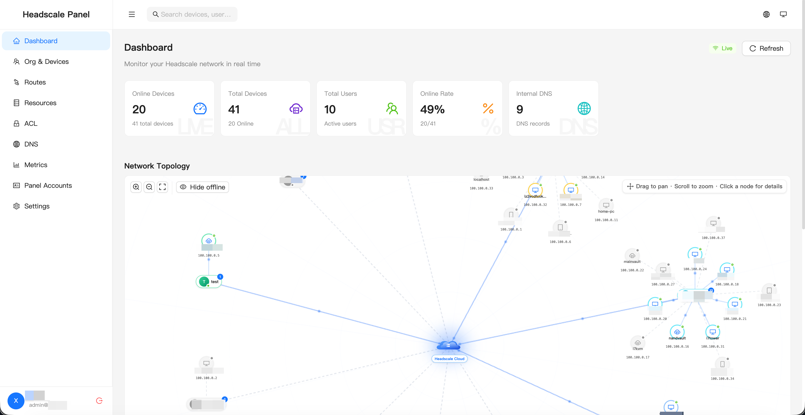
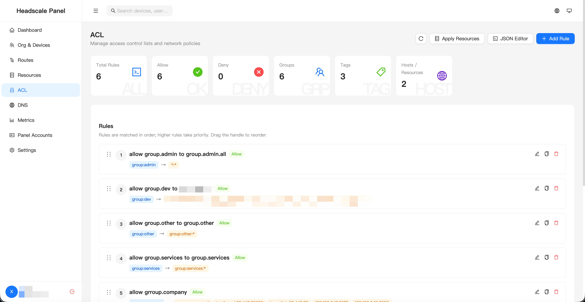
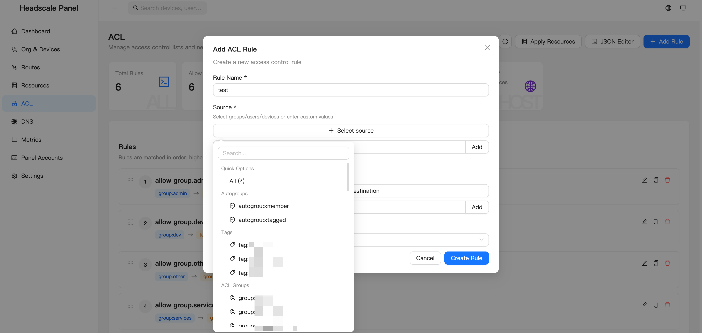
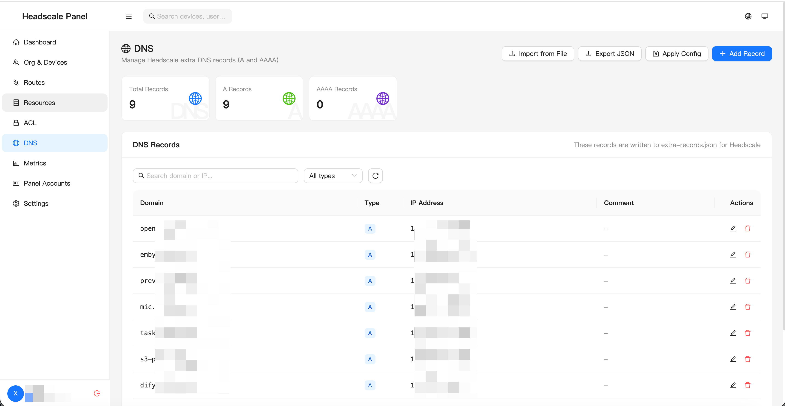
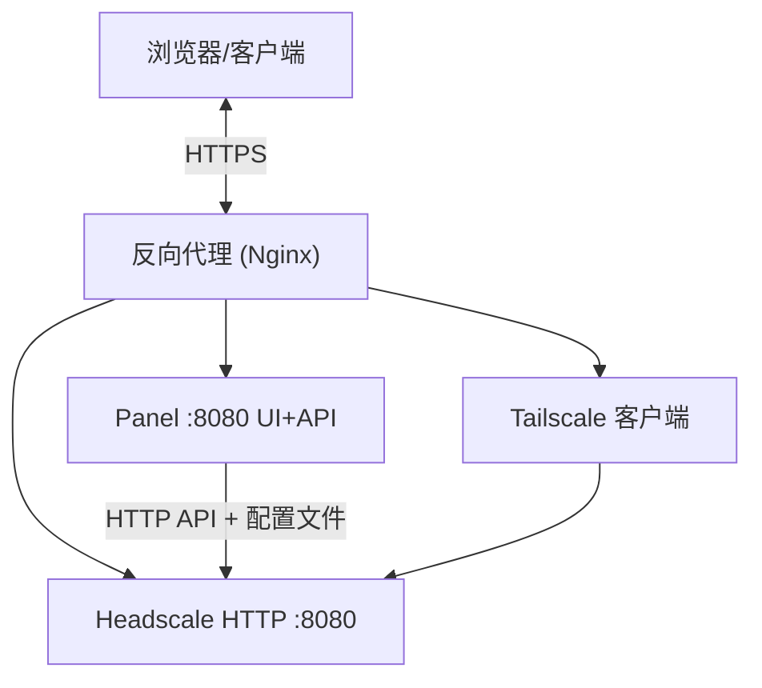

# Headscale Panel

<p align="center">
    <a href="README-zh.md">中文</a> |
    <a href="README.md">English</a>
</p>

<p align="center">
    <a href="LICENSE">
        
    </a>
    <a href="https://go.dev">
        
    </a>
    <a href="https://react.dev">
        
    </a>
</p>

> [!WARNING]
> 本项目目前处于非常初期的开发阶段，可能存在严重错误、功能缺失或完全不可用等问题。我们会积极跟进并解决已上报的 issue，并持续推进功能开发与 Bug 修复。非常不推荐用于公网及生产环境。

一个现代化的 Headscale 管理面板，提供简洁、面向网络运维的用户界面，支持设备管理、用户管理、ACL 可视化、路由管理、DNS 管理、在线时长统计等功能。

## 📸 界面截图

### 仪表盘



### ACL 管理





### DNS 管理



## ✨ 核心功能

### 🎨 现代化 UI
- **简洁控制台风格设计**：浅色主题，蓝色主色调，科技感十足
- **响应式布局**：支持桌面端和移动端
- **流畅动画**：平滑过渡和微交互效果
- **网络拓扑可视化**：实时展示设备连接关系及 ACL 访问矩阵
- **实时推送**：WebSocket 驱动的状态实时更新

### 📊 监控统计
- **在线时长统计**：基于 InfluxDB 的精确时长记录
- **设备状态监控**：实时显示设备在线/离线状态及历史曲线
- **流量统计**：设备流量趋势分析
- **数据可视化**：Recharts 图表展示

### 🛠️ 设备管理
- **设备列表**：查看所有已注册的设备
- **设备操作**：重命名、删除、过期、添加/修改标签
- **节点注册**：手动注册新节点到指定用户
- **筛选搜索**：按用户、状态、标签筛选
- **预授权密钥**：创建、查看、过期 PreAuthKey

### 👥 用户管理
- **Headscale 用户**：创建、重命名、删除 Headscale 网络用户
- **面板账户**：独立的面板登录账户管理，支持启用/禁用
- **网络身份绑定**：将面板账户与 Headscale 用户绑定，支持多身份
- **用户组与权限**：基于 RBAC 的用户组管理和细粒度权限分配
- **2FA 支持**：TOTP 两步验证

### 🔒 ACL 管理
- **可视化编辑**：图形化 ACL 规则编辑器，支持增删改
- **原始编辑**：直接编辑 HuJSON 原始策略内容
- **AI 辅助生成**：通过自然语言描述自动生成 ACL 规则
- **版本历史**：保留历史策略版本，支持回溯
- **访问检查**：验证特定源/目的之间的访问权限
- **一键应用**：将策略直接推送到 Headscale

### 🛣️ 路由管理
- **路由列表**：查看所有设备发布的子网路由
- **启用/禁用**：逐条控制路由的激活状态

### 🌐 DNS 管理
- **自定义记录**：管理 Headscale extra-records（A / AAAA 记录）

### 🔗 快速连接
- **命令生成**：自动生成连接命令
- **SSH 命令生成**：生成 tailscale SSH 连接命令
- **一键复制**：快速复制到剪贴板
- **PreAuthKey**：生成预授权密钥

### 📦 资源中心
- **资源管理**：以 IP + 端口形式定义内部资源（ACL 主机别名）
- **资源同步**：将资源自动同步为 ACL Hosts 条目
- **权限控制**：基于用户组的资源访问控制

### ⚙️ 系统设置
- **连接配置**：管理 Headscale HTTP API 地址和 API Key
- **数据同步**：从 Headscale 手动同步数据

### 🆔 OIDC Provider
- **内置 OIDC**：完整实现 OpenID Connect 服务，可作为 Headscale 的认证提供者
- **外部 OIDC 登录**：支持通过外部 OIDC 提供者登录面板
- **OAuth2 客户端**：管理第三方应用接入，支持密钥轮换
- **统一认证**：一套账号管理所有服务

---

## 🚀 快速开始

### 使用 Docker（推荐）

以下方式适用于镜像/部署场景；如果是本地开发，请参考下方[本地开发](#本地开发)章节。

**拉取镜像：**

```bash
docker pull ghcr.io/headscale-panel/panel:latest
```

**使用 Docker Compose（推荐）：**

将以下内容保存为 `docker-compose.yml`，按实际需求修改配置项，然后准备 Headscale 配置文件（见下方）。

```yaml
networks:
  private:
    driver: bridge
    ipam:
      config:
        - subnet: 172.20.200.0/24

  headscale-server:
    image: headscale/headscale:stable
    container_name: headscale-server
    hostname: headscale-server
    volumes:
      - ./headscale/config:/etc/headscale
      - ./headscale/data:/var/lib/headscale
    environment:
      TZ: Asia/Shanghai
    expose:
      - '8080'
    command: serve
    healthcheck:
      test: ["CMD", "headscale", "health"]
      interval: 5s
      timeout: 3s
      retries: 5
    networks:
      - private
    restart: unless-stopped
    tty: true

  headscale-panel:
    image: ghcr.io/headscale-panel/panel:latest
    container_name: headscale-panel
    hostname: headscale-panel
    volumes:
      - ./headscale/config:/app/headscale/etc
      - ./headscale/data:/app/headscale/lib
      - ./headscale/panel:/app/data
    environment:
      SYSTEM_BASE_URL: https://vpn.example.com/panel
      JWT_SECRET: 32_random_string
      JWT_EXPIRE: 24
    expose:
      - '8080'
    networks:
      - private
    depends_on:
      headscale-server:
        condition: service_healthy
    restart: unless-stopped
    tty: true
```

**启动服务：**

```bash
# 创建目录结构
mkdir -p headscale/config headscale/data panel/data

# 将下方 Headscale 配置写入 ./headscale/config/config.yaml

# 启动
docker compose up -d

# 生成 Headscale API Key（首次启动后执行）
docker exec headscale headscale apikeys create
```

首次访问面板（`http://localhost:8090` 或反向代理地址），进入初始化向导，在「连接配置」步骤填写：

- **API 地址**：`http://headscale:8080`（面板与 Headscale 位于同一 Docker 网络，直接使用服务名与 HTTP 端口）
- **API Key**：填入上方命令生成的 Key
- **允许明文 HTTP**：Headscale 的 HTTP 监听未启用 TLS 时勾选

### TLS 模式选择（初始化向导/设置页）

面板只使用 Headscale 的 **HTTP API**（0.30 起 gRPC 已移除），支持三种连接方式：

1. **明文 HTTP**
  - 适用于 Headscale 的 HTTP 端口未启用 TLS（内网典型场景）。
  - 配置：`允许明文 HTTP = 开启`。

2. **HTTPS + 跳过证书验证**
  - 适用于 Headscale 使用自签名证书。
  - 配置：`允许明文 HTTP = 关闭`，`跳过 TLS 证书验证 = 开启`。

3. **HTTPS + 自定义 CA 证书（推荐用于私有 PKI）**
  - 适用于证书由私有 CA 签发。
  - 配置：`允许明文 HTTP = 关闭`，`跳过 TLS 证书验证 = 关闭`，并在 `自定义 CA 证书（PEM）` 中粘贴 CA 的 PEM 内容。
  - 如果使用公网 CA（如 ZeroSSL），`自定义 CA 证书（PEM）` 保持为空即可（使用系统根证书）。

面板通过 HTTP API 连接 Headscale，需提前准备好 Headscale 配置文件。以下为推荐最小配置（`./headscale/config/config.yaml`）：

> **安全建议**：把 Headscale 的 HTTP 监听限制在内网，或在其前面终止 TLS。直接从公网暴露明文 HTTP 管理接口会让 API Key 以明文传输。

```yaml
server_url: https://vpn.example.com
listen_addr: 0.0.0.0:8080
metrics_listen_addr: 0.0.0.0:9090
noise:
    private_key_path: /var/lib/headscale/noise_private.key
prefixes:
    v4: 100.100.0.0/16
    v6: fd7a:115c:a1e0::/48
    allocation: sequential
derp:
    server:
        enabled: false
    paths:
        - /etc/headscale/derp-custom.yaml
database:
    type: sqlite
    sqlite:
        path: /var/lib/headscale/db.sqlite
        write_ahead_log: true
dns:
    base_domain: example.net
    magic_dns: true
    nameservers:
        global:
            - 1.1.1.1
            - 1.0.0.1
policy:
    mode: database
```

对应的推荐最小 `./headscale/config/derp-custom.yaml`

```yaml
regions:
  900:
    regionid: 900
    regioncode: custom
    regionname: My Region
    nodes:
      - name: 900a
        regionid: 900
        hostname: myderp.example.com
        stunport: 0
        stunonly: false
        derpport: 0
```

> 更多配置项请参考：https://headscale.net/stable/ref/configuration/

### 环境变量

只有决定进程如何部署的配置放在环境变量里；能在地面页修改的一律存入数据库。

| 变量名                         | 说明                                                                     | 默认值                  |
| ------------------------------ | ------------------------------------------------------------------------ | ----------------------- |
| `SYSTEM_PORT`                  | 面板监听端口                                                             | `:8080`                 |
| `SYSTEM_BASE_URL`              | 面板外部访问地址（IdP issuer、cookie、CORS 均依赖）                      | `http://localhost:8080` |
| `SYSTEM_DEBUG`                 | 从磁盘直出前端并开启调试路由                                             | `false`                 |
| `SYSTEM_SETUP_BOOTSTRAP_TOKEN` | 初始化引导令牌（≥32 字符，留空则不启用）                                 | —                       |
| `JWT_SECRET`                   | **必填。** 用于加密存储的凭据（Headscale API Key）。≥32 字符，禁用占位值 | —                       |
| `JWT_EXPIRE`                   | 访问令牌有效期（小时）                                                   | `24`                    |
| `JWT_KEY_DIR`                  | RSA 令牌签名密钥存放目录                                                 | `data/keys`             |
| `DATA_DIR`                     | 数据库、密钥与 Headscale 文件的父目录                                    | `data`                  |
| `DB_PATH`                      | SQLite 数据库文件                                                        | `data/data.db`          |
| `HEADSCALE_ETC_DIR`            | 面板侧挂载的 Headscale `/etc/headscale`                                  | `data/headscale/etc`    |
| `HEADSCALE_LIB_DIR`            | 面板侧挂载的 Headscale `/var/lib/headscale`                              | `data/headscale/lib`    |
| `FRONTEND_DIR`                 | 编译后的前端资源目录（相对可执行文件）                                   | `frontend`              |
| `INFLUXDB_URL`                 | InfluxDB 地址（留空则禁用指标统计）                                      | —                       |
| `INFLUXDB_TOKEN`               | InfluxDB 认证 Token                                                      | —                       |
| `INFLUXDB_ORG`                 | InfluxDB 组织名                                                          | `headscale-panel`       |
| `INFLUXDB_BUCKET`              | InfluxDB Bucket 名                                                       | `metrics`               |
| `HS_LIFECYCLE_ENABLED`         | 允许面板启停 Headscale 容器                                              | `false`                 |
| `HS_LIFECYCLE_MODE`            | 启停方式（仅支持 `docker`）                                              | `docker`                |
| `HS_CONTAINER_NAME`            | 被控制的 Headscale 容器名（启用 lifecycle 时必填）                       | —                       |

`JWT_SECRET` 不再自动生成。它用于加密存储的 Headscale API Key，若每个进程随机生成，重启后所有凭据将永久无法解密。缺失或过短会直接启动失败并报错。

访问令牌的签名使用 `JWT_KEY_DIR` 下的 RSA 密钥，不再使用 `JWT_SECRET`。备份时请把 `data/keys/` 与 `data/data.db` 一起备份；只恢复其中一个会导致会话失效且已存凭据无法解密。

## 🏗️ 架构说明



- **Headscale Panel**（本项目）：管理面板，提供 Web UI 和 REST API。通过 Headscale 的 HTTP API 通信并编辑其配置文件，**不读写 Headscale 的数据库**。
- **Headscale**：VPN 控制平面，Tailscale 客户端直接连接此服务（不经过面板）。

`pkg/hsapi` 是面板访问 Headscale 的唯一出口。

---

## 🌐 反向代理配置

推荐将面板挂载在 `/panel/` 路径下，与 Headscale 共用同一域名。以下为 Nginx 示例（`SYSTEM_BASE_URL=https://vpn.example.com/panel`）：

```nginx
server {
    listen 443 ssl http2;
    server_name vpn.example.com;

    ssl_certificate     /etc/ssl/certs/vpn.example.com/fullchain.pem;
    ssl_certificate_key /etc/ssl/private/vpn.example.com/privkey.pem;

    location ^~ /panel/ {
        proxy_pass http://headscale-panel:8080;
        proxy_set_header Host $host;
        proxy_set_header X-Real-IP $remote_addr;
        proxy_set_header X-Forwarded-For $proxy_add_x_forwarded_for;
        proxy_set_header X-Forwarded-Proto $scheme;
        proxy_http_version 1.1;
        proxy_set_header Upgrade $http_upgrade;
        proxy_set_header Connection "upgrade";
    }

    location ^~ / {
        proxy_pass http://headscale-server:8080;
        proxy_set_header Host $host;
        proxy_set_header X-Real-IP $remote_addr;
        proxy_set_header X-Forwarded-For $proxy_add_x_forwarded_for;
        proxy_set_header X-Forwarded-Proto $scheme;
        proxy_http_version 1.1;
        proxy_set_header Upgrade $http_upgrade;
        proxy_set_header Connection "upgrade";
    }
}
```

> 使用面板内置 OIDC 时，还需确保 `/.well-known/openid-configuration` 和 `/api/v1/oidc/` 路径能到达面板（即额外添加对应 `location` 块，`proxy_pass` 同面板地址）。

---

## 🧭 Headscale 适配进度

面板通过 Headscale 的 HTTP API 通信，并针对一个特定的上游 commit 适配。升级 Headscale 之前请先核对下表。

| 项         | 值                                                                                                                        |
| ---------- | ------------------------------------------------------------------------------------------------------------------------- |
| 适配基线   | `juanfont/headscale@0c304b0632db524356e940fc74dc6230e790d11d`                                                             |
| 基线版本   | `0.30.0-dev`                                                                                                              |
| 版本门禁   | 能力探测——`/api/v1/health` 有响应即视为 ≥ 0.30。`/version` 的版本字符串在开发构建中可能为空或 `dev`，因此不作为门禁依据。 |
| 使用的 API | `/api/v1/{apikey,auth,config,health,node,policy,preauthkey,user}`                                                         |
| 未使用     | `/api/v2/oauth`、`/api/v2/keys` 写操作、`PATCH /api/v2/tailnet/-/settings`（上游返回 501）                                |

升级 Headscale 均通过 `mise` 执行：

```bash
# 1) 查看上游变更
mise run hs:diff -- <旧版本> <新版本>

# 2) 为新 commit 重新生成并入库 OpenAPI 文档
mise run hs:vendor-spec -- <新版本>
# 然后更新 backend/pkg/hsapi/adapted.go 中的 AdaptedHeadscaleCommit
```

`mise run hs:check-drift` 会在适配基线与入库的 OpenAPI 文档不一致时让 CI 失败。

## 🔧 开发指南

项目工具链与全部开发/运维脚本统一由根目录单一 [`mise.toml`](mise.toml) 管理。完整的从零启动手册见 [`docs/dev-handbook-zh.md`](docs/dev-handbook-zh.md)。

### 前置要求

- Docker + Docker Compose（含 `docker compose` 插件）及 `/dev/net/tun`
- [`mise`](https://mise.jdx.dev/)
- `openssl`、`jq`

### 一条命令起本地组网环境

所有本地开发环境产生的数据集中存放在根目录 `dev-data/`（已加入 `.gitignore`），不再污染 `shell/` 目录。

```bash
mise trust mise.toml && mise install
mise run dev:up             # 默认设计：直接运行正式版 Headscale 镜像
mise run dev:up:source      # 临时模式：按 AdaptedHeadscaleCommit 拉取源码构建本地 Headscale 镜像并启动
mise run dev:up:host:source # 基础设施在容器内，面板在宿主机通过 `mise run backend:dev` 运行
mise run dev:verify         # 端到端组网断言
mise run dev:logs           # 跟踪日志，可传服务名
mise run dev:down           # 停止，保留数据卷与 dev-data/
mise run dev:reset          # 全部销毁，包括容器、卷与 dev-data/
```

| 地址               | 值                                                                               |
| ------------------ | -------------------------------------------------------------------------------- |
| Headscale HTTP API | http://localhost:5080                                                            |
| 面板               | http://localhost:8090/panel                                                      |
| InfluxDB           | http://localhost:8086                                                            |
| 组网目标           | http://172.31.0.10（`target-a`，net-a）、http://172.32.0.10（`target-b`，net-b） |

**网络布局** —— 两个客户端不共享任何网桥，因此它们之间的任何连通都必须经过 Headscale：

```
core         headscale, panel, influxdb
net-a        172.31.0.0/24   client-a (172.31.0.20), target-a (172.31.0.10)
net-b        172.32.0.0/24   client-b (172.32.0.20), target-b (172.32.0.10)
```

`client-a` 广播 `172.31.0.0/24`，`client-b` 接受路由。在路由被批准之前不会通，这正是 `verify.sh` 验证的内容：

1. `client-a` 无法访问 `172.32.0.10`（网桥隔离）
2. 两个客户端都出现在 `tailscale status` 中
3. `client-b` 无法访问 `172.31.0.10`（路由尚未批准）
4. `POST /api/v1/node/{id}/approve_routes` 批准 `172.31.0.0/24`
5. `client-b` 经 `client-a` 访问到 `172.31.0.10`
6. `/api/v1/node` 报告 2/2 节点在线

> 跨网桥流量通过 DERP 中转，因此两个客户端需要能访问 `controlplane.tailscale.com`。若需完全离线，请把 `shell/docker/dev/headscale/config.main.yaml.tpl` 中的 `derp.urls` 替换为自建 DERP 地图。

### Profile

开发环境始终运行适配基线版本。`./shell/dev/up.sh` 在本地没有镜像时会从源码构建，
因为上游没有为未发布的 0.30 commit 提供镜像（ko 仅按 commit digest 打 tag）；
构建使用 `shell/tools/build-hs-image.sh` 与 `AdaptedHeadscaleCommit`。

### TLS 证书

开发环境默认在 Docker 网络内使用明文 HTTP。只有需要验证面板的 TLS 选项时才需要证书：

```bash
mise run certs:self-signed   # SAN 覆盖 headscale、panel、localhost 与宿主 IP
mise run certs:private-ca    # 私有 CA；把 ca.crt 粘贴到面板
```

产物写入 `dev-data/cert`。在 headscale 容器内把 `tls.cert_path` / `tls.key_path` 指向它们。

### 从面板启停 Headscale

面板可以启停由 Docker 管理的 Headscale，默认关闭：

| 变量                   | 默认值   | 说明                                                                |
| ---------------------- | -------- | ------------------------------------------------------------------- |
| `HS_LIFECYCLE_ENABLED` | `false`  | 总开关。开发用 compose 中也是 `false`，保证手动重启路径始终被验证。 |
| `HS_LIFECYCLE_MODE`    | `docker` | 仅支持 `docker`。                                                   |
| `HS_CONTAINER_NAME`    | —        | 必填，必须与实际运行的容器名一致。                                  |

开启时需要把 `/var/run/docker.sock`（读写）挂载进面板容器，开发用 compose 已处理。关闭时，所有需要重启的操作都会返回可直接复制的命令提示。

### 构建 Docker 镜像

```bash
docker build -t headscale-panel .
```

---

## 📄 License

GNU AGPLv3
