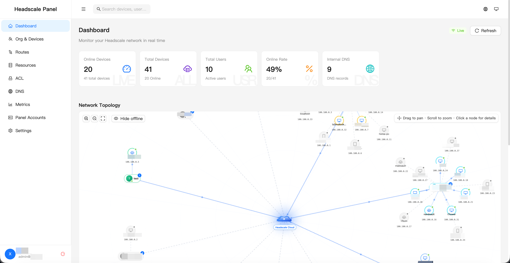
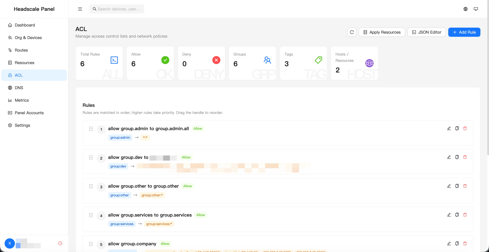
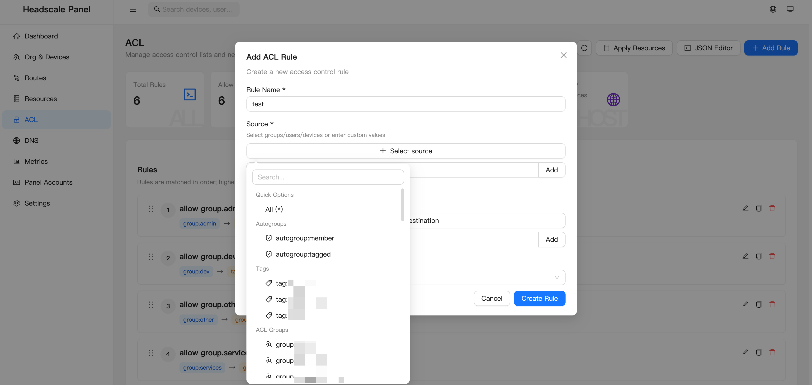
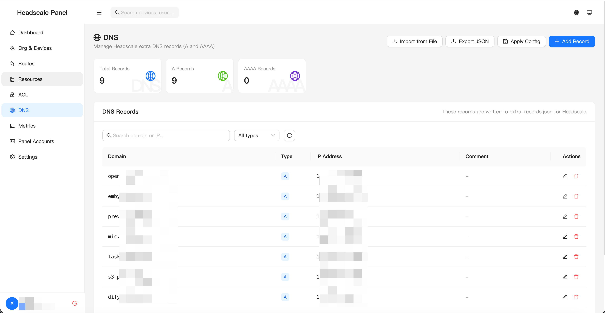
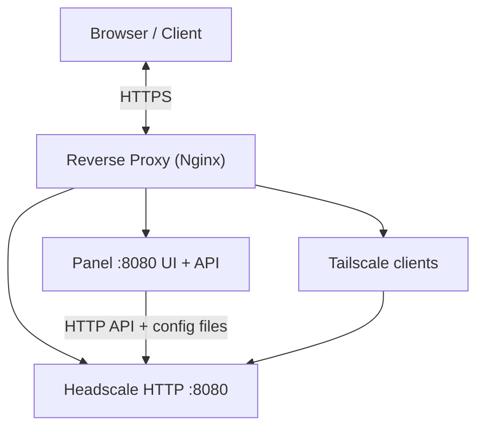

# Headscale Panel

<p align="center">
    <a href="README-zh.md">中文</a> |
    <a href="README.md">English</a>
</p>

<p align="center">
    <a href="LICENSE">
        
    </a>
    <a href="https://go.dev">
        
    </a>
    <a href="https://react.dev">
        
    </a>
</p>

> [!WARNING]
> This project is in a very early stage of development. You may encounter critical bugs, missing features, or complete unavailability. We are actively working to resolve reported issues and will continue to push forward with fixes and new features. Use on public networks or in production environments is strongly discouraged.

A modern Headscale management panel with a clean, network-operations-focused UI. Supports device management, user management, ACL visualization, route management, DNS management, uptime statistics, and more.

## 📸 Screenshots

### Dashboard



### ACL





### DNS



## ✨ Features

### 🎨 Modern UI
- **Clean dashboard design**: Light theme with a blue accent color palette
- **Responsive layout**: Works on both desktop and mobile
- **Smooth animations**: Polished transitions and micro-interactions
- **Network topology visualization**: Real-time device connection graph and ACL access matrix
- **Real-time updates**: WebSocket-powered live state refresh

### 📊 Monitoring & Statistics
- **Uptime tracking**: Accurate session duration recording backed by InfluxDB
- **Device status monitoring**: Real-time online/offline indicators with historical charts
- **Traffic statistics**: Device traffic trend analysis
- **Data visualization**: Interactive charts powered by Recharts

### 🛠️ Device Management
- **Device list**: Browse all registered devices
- **Device actions**: Rename, delete, expire, add/edit tags
- **Node registration**: Manually register new nodes to a specific user
- **Filtering & search**: Filter by user, status, or tag
- **Pre-auth keys**: Create, view, and expire PreAuthKeys

### 👥 User Management
- **Headscale users**: Create, rename, and delete Headscale network users
- **Panel accounts**: Standalone panel login accounts with enable/disable support
- **Identity binding**: Bind panel accounts to Headscale users (multiple identities supported)
- **Groups & permissions**: RBAC-based group management with fine-grained permission assignment
- **2FA support**: TOTP two-factor authentication

### 🔒 ACL Management
- **Visual editor**: Graphical ACL rule editor with add/edit/delete support
- **Raw editor**: Direct HuJSON policy editing
- **AI-assisted generation**: Auto-generate ACL rules from natural language descriptions
- **Version history**: Keeps historical policy versions for rollback
- **Access check**: Verify access permissions between a given source and destination
- **One-click apply**: Push the policy directly to Headscale

### 🛣️ Route Management
- **Route list**: View all subnet routes advertised by devices
- **Enable/Disable**: Toggle individual route activation state

### 🌐 DNS Management
- **Custom records**: Manage Headscale extra-records (A / AAAA records)

### 🔗 Quick Connect
- **Command generation**: Auto-generate connection commands
- **SSH command generation**: Generate Tailscale SSH connection commands
- **One-click copy**: Copy to clipboard instantly
- **PreAuthKey**: Generate pre-authorization keys

### 📦 Resource Center
- **Resource management**: Define internal resources by IP + port (ACL host aliases)
- **Resource sync**: Automatically sync resources as ACL Hosts entries
- **Access control**: Group-based resource access control

### ⚙️ System Settings
- **Connection config**: Manage the Headscale HTTP API address and API key
- **Data sync**: Manually sync data from Headscale

### 🆔 OIDC Provider
- **Built-in OIDC**: Full OpenID Connect implementation — use this panel as Headscale's authentication provider
- **External OIDC login**: Log in to the panel via an external OIDC provider
- **OAuth2 clients**: Manage third-party application access with key rotation support
- **Unified authentication**: One account for all services

---

## 🚀 Quick Start

### Using Docker (Recommended)

The steps below are for deploying a production instance. For local development, see the [Development](#development) section below.

**Pull the image:**

```bash
docker pull ghcr.io/headscale-panel/panel:latest
```

**Using Docker Compose (Recommended):**

Save the following as `docker-compose.yml`, adjust configuration items according to your actual needs, then prepare the Headscale config file (see below).

```yaml
networks:
  private:
    driver: bridge
    ipam:
      config:
        - subnet: 172.20.200.0/24

  headscale-server:
    image: headscale/headscale:stable
    container_name: headscale-server
    hostname: headscale-server
    volumes:
      - ./headscale/config:/etc/headscale
      - ./headscale/data:/var/lib/headscale
    environment:
      TZ: Asia/Shanghai
    expose:
      - '8080'
    command: serve
    healthcheck:
      test: ["CMD", "headscale", "health"]
      interval: 5s
      timeout: 3s
      retries: 5
    networks:
      - private
    restart: unless-stopped
    tty: true

  headscale-panel:
    image: ghcr.io/headscale-panel/panel:latest
    container_name: headscale-panel
    hostname: headscale-panel
    volumes:
      - ./headscale/config:/app/headscale/etc
      - ./headscale/data:/app/headscale/lib
      - ./headscale/panel:/app/data
    environment:
      SYSTEM_BASE_URL: https://vpn.example.com/panel
      JWT_SECRET: 32_random_string
      JWT_EXPIRE: 24
    expose:
      - '8080'
    networks:
      - private
    depends_on:
      headscale-server:
        condition: service_healthy
    restart: unless-stopped
    tty: true
```

**Start the services:**

```bash
# Create the directory structure
mkdir -p headscale/config headscale/data panel/data

# Write the Headscale config to ./headscale/config/config.yaml (see below)

# Start
docker compose up -d

# Generate a Headscale API key (run after first startup)
docker exec headscale headscale apikeys create
```

On first access (`http://localhost:8090` or your reverse-proxy address), the setup wizard will open. In the **Connection** step, fill in:

- **API address**: `http://headscale:8080` (panel and Headscale share the same Docker network — use the service name and the HTTP port)
- **API Key**: the key generated by the command above
- **Allow plain HTTP**: check this when Headscale's HTTP listener has no TLS

### TLS Mode Selection (Setup/Settings)

The panel talks to Headscale over its **HTTP API** only (gRPC was removed in 0.30). Three connection modes:

1. **Plain HTTP**
  - Use when Headscale's HTTP listener has no TLS, which is the normal case on a private network.
  - Setup: `Allow plain HTTP = ON`.

2. **HTTPS + Skip certificate verification**
  - Use for self-signed server certificates.
  - Setup: `Allow plain HTTP = OFF`, `Skip TLS Certificate Verification = ON`.

3. **HTTPS + Custom CA certificate (recommended for private PKI)**
  - Use when the certificate is signed by your private CA.
  - Setup: `Allow plain HTTP = OFF`, `Skip TLS Certificate Verification = OFF`, then paste CA PEM into `Custom CA Certificate (PEM)`.
  - For public CAs (e.g. ZeroSSL), keep `Custom CA Certificate (PEM)` empty to use system trust roots.

The panel connects to Headscale over HTTP. Below is the recommended minimal Headscale config (`./headscale/config/config.yaml`):

> **Security recommendation**: keep Headscale's HTTP listener on an internal network, or terminate TLS in front of it. Exposing a plain-HTTP management API to the internet sends the API key in clear text.

```yaml
server_url: https://vpn.example.com
listen_addr: 0.0.0.0:8080
metrics_listen_addr: 0.0.0.0:9090
noise:
    private_key_path: /var/lib/headscale/noise_private.key
prefixes:
    v4: 100.100.0.0/16
    v6: fd7a:115c:a1e0::/48
    allocation: sequential
derp:
    server:
        enabled: false
    paths:
        - /etc/headscale/derp-custom.yaml
database:
    type: sqlite
    sqlite:
        path: /var/lib/headscale/db.sqlite
        write_ahead_log: true
dns:
    base_domain: example.net
    magic_dns: true
    nameservers:
        global:
            - 1.1.1.1
            - 1.0.0.1
policy:
    mode: database
```

Corresponding recommended minimal `./headscale/config/derp-custom.yaml`:

```yaml
regions:
  900:
    regionid: 900
    regioncode: custom
    regionname: My Region
    nodes:
      - name: 900a
        regionid: 900
        hostname: myderp.example.com
        stunport: 0
        stunonly: false
        derpport: 0
```

> For additional configuration options, see: https://headscale.net/stable/ref/configuration/

### Environment Variables

Only settings that decide how the process is deployed live here. Anything an
operator can change from the UI is stored in the database instead.

| Variable                       | Description                                                                                             | Default                 |
| ------------------------------ | ------------------------------------------------------------------------------------------------------- | ----------------------- |
| `SYSTEM_PORT`                  | Panel listen port                                                                                       | `:8080`                 |
| `SYSTEM_BASE_URL`              | External panel URL (derives the IdP issuer, cookies and CORS)                                           | `http://localhost:8080` |
| `SYSTEM_DEBUG`                 | Serve frontend from disk and enable debug routes                                                        | `false`                 |
| `SYSTEM_SETUP_BOOTSTRAP_TOKEN` | Setup wizard bootstrap token (≥32 chars; disabled if empty)                                             | —                       |
| `JWT_SECRET`                   | **Required.** Encrypts stored credentials (the Headscale API key). ≥32 chars, must not be a placeholder | —                       |
| `JWT_EXPIRE`                   | Access token lifetime in hours                                                                          | `24`                    |
| `JWT_KEY_DIR`                  | Where the RSA token-signing key is stored                                                               | `data/keys`             |
| `DATA_DIR`                     | Parent directory for the database, keys and Headscale files                                             | `data`                  |
| `DB_PATH`                      | SQLite database file                                                                                    | `data/data.db`          |
| `HEADSCALE_ETC_DIR`            | Panel-side mount for Headscale's `/etc/headscale`                                                       | `data/headscale/etc`    |
| `HEADSCALE_LIB_DIR`            | Panel-side mount for Headscale's `/var/lib/headscale`                                                   | `data/headscale/lib`    |
| `FRONTEND_DIR`                 | Compiled frontend assets, relative to the binary                                                        | `frontend`              |
| `INFLUXDB_URL`                 | InfluxDB address (metrics disabled if empty)                                                            | —                       |
| `INFLUXDB_TOKEN`               | InfluxDB authentication token                                                                           | —                       |
| `INFLUXDB_ORG`                 | InfluxDB organization                                                                                   | `headscale-panel`       |
| `INFLUXDB_BUCKET`              | InfluxDB bucket                                                                                         | `metrics`               |
| `HS_LIFECYCLE_ENABLED`         | Allow the panel to start/stop/restart the Headscale container                                           | `false`                 |
| `HS_LIFECYCLE_MODE`            | Container runtime; only `docker` is supported                                                           | `docker`                |
| `HS_CONTAINER_NAME`            | Headscale container name; required when lifecycle is enabled                                            | —                       |

`JWT_SECRET` is no longer auto-generated. It encrypts the stored Headscale API
key, so a per-session random value would make every credential unreadable after a
restart. A missing or too-short value stops the process with an explicit error.

Access tokens are signed with an RSA key in `JWT_KEY_DIR`, not with
`JWT_SECRET`. Back up `data/keys/` together with `data/data.db`; restoring one
without the other leaves sessions invalid and stored credentials undecryptable.


---

## 🏗️ Architecture



- **Headscale Panel** (this project): management UI and REST API. It reaches
  Headscale over its HTTP API and edits Headscale's config file; it never touches
  Headscale's database.
- **Headscale**: the VPN control plane. Tailscale clients connect to it directly,
  not through the panel.

`pkg/hsapi` is the panel's only path to Headscale.


---

## 🌐 Reverse Proxy Configuration

It is recommended to mount the panel under a `/panel/` path and share the same domain as Headscale. Below is an Nginx example (`SYSTEM_BASE_URL=https://vpn.example.com/panel`):

```nginx
server {
    listen 443 ssl http2;
    server_name vpn.example.com;

    ssl_certificate     /etc/ssl/certs/vpn.example.com/fullchain.pem;
    ssl_certificate_key /etc/ssl/private/vpn.example.com/privkey.pem;

    location ^~ /panel/ {
        proxy_pass http://headscale-panel:8080;
        proxy_set_header Host $host;
        proxy_set_header X-Real-IP $remote_addr;
        proxy_set_header X-Forwarded-For $proxy_add_x_forwarded_for;
        proxy_set_header X-Forwarded-Proto $scheme;
        proxy_http_version 1.1;
        proxy_set_header Upgrade $http_upgrade;
        proxy_set_header Connection "upgrade";
    }

    location ^~ / {
        proxy_pass http://headscale-server:8080;
        proxy_set_header Host $host;
        proxy_set_header X-Real-IP $remote_addr;
        proxy_set_header X-Forwarded-For $proxy_add_x_forwarded_for;
        proxy_set_header X-Forwarded-Proto $scheme;
        proxy_http_version 1.1;
        proxy_set_header Upgrade $http_upgrade;
        proxy_set_header Connection "upgrade";
    }
}
```

> When using the built-in OIDC provider, also ensure that `/.well-known/openid-configuration` and `/api/v1/oidc/` paths route to the panel (add corresponding `location` blocks with the same `proxy_pass` address).

---

## 🧭 Headscale Compatibility

The panel talks to Headscale over its HTTP API and targets one specific upstream
commit. Before upgrading Headscale, check this table.

| Item                  | Value                                                                                                                                                         |
| --------------------- | ------------------------------------------------------------------------------------------------------------------------------------------------------------- |
| Adapted commit        | `juanfont/headscale@0c304b0632db524356e940fc74dc6230e790d11d`                                                                                                 |
| Adapted version       | `0.30.0-dev`                                                                                                                                                  |
| Gate                  | capability probe — `/api/v1/health` responding means ≥ 0.30. The `/version` string is never used as a gate because dev builds report an empty or `dev` value. |
| APIs used             | `/api/v1/{apikey,auth,config,health,node,policy,preauthkey,user}`                                                                                             |
| Not used              | `/api/v2/oauth`, `/api/v2/keys` writes, `PATCH /api/v2/tailnet/-/settings` (upstream returns 501)                                                             |

Upgrading Headscale is managed via `mise`:

```bash
# 1) See what changed upstream
mise run hs:diff -- <old-ref> <new-ref>

# 2) Refresh the vendored OpenAPI document for the new commit
mise run hs:vendor-spec -- <new-ref>
# then update AdaptedHeadscaleCommit in backend/pkg/hsapi/adapted.go
```

`mise run hs:check-drift` fails CI when the adapted commit and the
vendored OpenAPI document disagree.

## 🔧 Development

The project toolchain and all development/ops scripts are managed in a single root [`mise.toml`](mise.toml). For the complete from-zero startup guide, see [`docs/dev-handbook.md`](docs/dev-handbook.md).

### Prerequisites

- Docker + Docker Compose (with the `docker compose` plugin) and `/dev/net/tun`
- [`mise`](https://mise.jdx.dev/)
- `openssl`, `jq`

### One-Command Local Tailnet

All runtime data generated by the local dev stack is stored in root `dev-data/` (git-ignored) instead of polluting `shell/`.

```bash
mise trust mise.toml && mise install
mise run dev:up             # release Headscale image mode (default design)
mise run dev:up:source      # temporary mode: build Headscale from AdaptedHeadscaleCommit source
mise run dev:up:host:source # infra in Docker; run panel locally via `mise run backend:dev`
mise run dev:verify         # end-to-end tailnet assertions
mise run dev:logs           # follow everything, or pass service names
mise run dev:down           # stop, keep volumes and dev-data/
mise run dev:reset          # destroy containers, volumes, and dev-data/
```

| Address            | Value                                                                          |
| ------------------ | ------------------------------------------------------------------------------ |
| Headscale HTTP API | http://localhost:5080                                                          |
| Panel              | http://localhost:8090/panel                                                    |
| InfluxDB           | http://localhost:8086                                                          |
| Tailnet targets    | http://172.31.0.10 (`target-a`, net-a), http://172.32.0.10 (`target-b`, net-b) |

**Network layout** — the two clients never share a bridge, so any connectivity
between them has to travel through Headscale:

```
core         headscale, panel, influxdb
net-a        172.31.0.0/24   client-a (172.31.0.20), target-a (172.31.0.10)
net-b        172.32.0.0/24   client-b (172.32.0.20), target-b (172.32.0.10)
```

`client-a` advertises `172.31.0.0/24`; `client-b` accepts routes. Nothing
crosses until the route is approved, which is exactly what `verify.sh` checks:

1. `client-a` cannot reach `172.32.0.10` (bridges are isolated)
2. both clients appear in `tailscale status`
3. `client-b` cannot reach `172.31.0.10` (route approved yet?)
4. `POST /api/v1/node/{id}/approve_routes` for `172.31.0.0/24`
5. `client-b` reaches `172.31.0.10` through `client-a`
6. `/api/v1/node` reports 2/2 nodes online

> Cross-bridge traffic is relayed through a DERP server, so the two clients need
> outbound internet access to `controlplane.tailscale.com`. For a fully offline
> setup, replace `derp.urls` in `shell/docker/dev/headscale/config.main.yaml.tpl`
> with your own DERP map.

### Profile

The dev stack always runs the adapted baseline. `./shell/dev/up.sh` builds the
headscale image from source if it is not present, because upstream does not
publish images for unreleased 0.30 commits (ko only tags by commit digest);
building uses `shell/tools/build-hs-image.sh` and `AdaptedHeadscaleCommit`.

### TLS Certificates

Dev defaults to plain HTTP inside the Docker network. Certificates are only
needed when exercising the panel's TLS options:

```bash
mise run certs:self-signed   # SAN covers headscale, panel, localhost, host IP
mise run certs:private-ca    # private CA; paste ca.crt into the panel
```

Artifacts land in `dev-data/cert`. Point `tls.cert_path` /
`tls.key_path` at them inside the headscale container.

### Controlling Headscale From The Panel

The panel can start, stop and restart a Docker-managed Headscale. It is opt-in:

| Variable               | Default  | Meaning                                                                        |
| ---------------------- | -------- | ------------------------------------------------------------------------------ |
| `HS_LIFECYCLE_ENABLED` | `false`  | Master switch. Off in the dev compose too, so the manual path stays exercised. |
| `HS_LIFECYCLE_MODE`    | `docker` | Only `docker` is supported.                                                    |
| `HS_CONTAINER_NAME`    | —        | Required. Must match the running container name.                               |

When enabled you must mount `/var/run/docker.sock` (read-write) into the panel
container; the dev compose already does. When disabled, every action that would
require a restart returns a copy-pasteable manual command instead.

### Building the Docker Image

```bash
docker build -t headscale-panel .
```

---

## 📄 License

GNU AGPLv3
